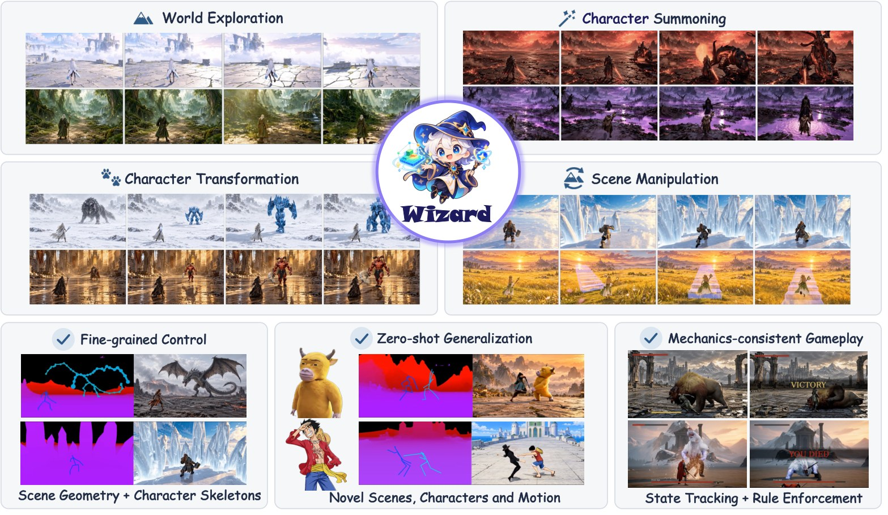
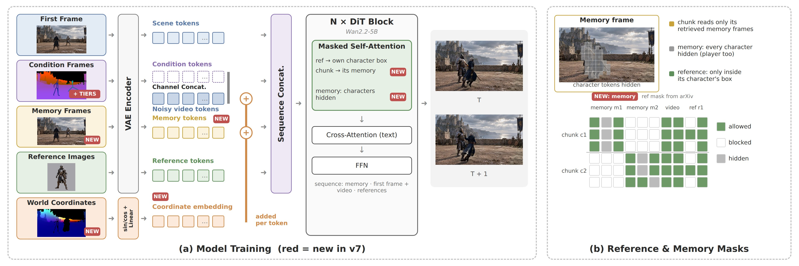

<div align="center">

# Wizard: Manipulate Any World in Real Time via Agentic Control

**Training and inference code for the Wizard video generator**

[](https://arxiv.org/abs/2610.40339)
[](https://wyzardwu.github.io/wizard/)




</div>

Wizard turns any scene image and any character references into a playable, real-time game world. An agent keeps the
game state (scene geometry, character skeletons, combat logic) and renders it into a **visual proxy**; a video model
built on [Wan2.2-TI2V-5B](https://github.com/Wan-Video/Wan2.2) turns the proxy into game frames, streaming at
**24 FPS with 2 denoising steps**.

This repository contains the **video generator**: the four-stage training pipeline (bidirectional teacher → causal
teacher → consistency distillation → DMD) and the three inference modes, including online world maintenance.

## Highlights

- **Proxy-driven control.** Scene geometry and articulated skeletons are rendered into one condition video and
  concatenated with the video latents on the channels: precise camera and motion control, zero-shot to new scenes,
  characters and motions.
- **Identity binding.** Each reference image is visible only inside its character's skeleton box.
- **Geometry you can trust.** The proxy marks every pixel as *exact*, *coarse* or *unknown*; the model follows exact
  geometry and invents unknown regions.
- **Spatial memory.** World-coordinate tokens and retrieved memory frames let the model redraw a place it has seen
  when the camera comes back.
- **Real time.** A causal 2-step student with a KV cache (20-frame window + attention sink), distilled with history
  self-augmentation and DMD; the world is maintained online on a second GPU without blocking generation.

## What is new compared with the paper

| | Paper (arXiv v1) | This release |
|---|---|---|
| Visual proxy | height / depth, G = 0 | + per-pixel tier (sky / unknown / coarse / exact) with normal shading, outlined skeletons, weapons, shields |
| World tokens | – | world coordinates + tier, added to every video and memory token |
| Memory | – | per-chunk retrieved memory frames, all characters hidden |
| Causal training | teacher forcing → CD → DMD | + history self-augmentation; memory and world tokens in every stage |
| Beyond the first view | invented terrain | marked *unknown*, then filled online from the generated frames |

<div align="center"></div>

## Installation

```bash
git clone https://github.com/wyzardWu/wizard27-clean.git && cd wizard27-clean
conda create -n wizard python=3.12 -y && conda activate wizard
pip install torch==2.11.0 torchvision --index-url https://download.pytorch.org/whl/cu128
pip install -r requirements.txt
pip install -e .
```

`ffmpeg` must be on the `PATH`. Download the official [Wan2.2-TI2V-5B](https://huggingface.co/Wan-AI/Wan2.2-TI2V-5B)
weights (VAE, T5 and tokenizer are used as-is) and point `WAN_CKPT` at the folder.

Online world maintenance additionally needs [MapAnything](https://github.com/facebookresearch/map-anything); it can live
in its own environment (see [docs/INFERENCE.md](docs/INFERENCE.md)).

## Quick start

```bash
export WAN_CKPT=/path/to/Wan2.2-TI2V-5B

# real-time 2-step student on a prepared case (241 frames)
bash scripts/infer/run_case.sh causal checkpoints/dmd.safetensors cases/my_case out.mp4 --ref1 boss.png --ref-slots 2,0

# the same with an online-maintained 3D world; FAST=1 runs the maintenance on the second GPU
CUDA_VISIBLE_DEVICES=0,1 FAST=1 bash scripts/infer/run_case.sh world checkpoints/dmd.safetensors cases/my_case out.mp4
```

Each run writes `out.mp4` (generation | proxy) and `out_gen.mp4` (generation only). The case format is described in
[docs/DATA.md](docs/DATA.md).

## Training

| Stage | Module | Script |
|---|---|---|
| 1. Bidirectional teacher | `wizard.train.bidirectional` | `scripts/train/1_bidirectional.sh` |
| 2. Causal teacher forcing | `wizard.train.causal` | `scripts/train/2_causal.sh` |
| 2b. History self-augmentation | `wizard.train.causal_selfaug` | `scripts/train/3_causal_selfaug.sh` |
| 3. Consistency distillation | `wizard.distill.consistency_selfaug` | `scripts/train/4_consistency.sh` |
| 4. Distribution matching distillation | `wizard.distill.dmd` | `scripts/train/5_dmd.sh` |

Commands, hyper-parameters and the data layout: [docs/TRAINING.md](docs/TRAINING.md) and [docs/DATA.md](docs/DATA.md).

## Checkpoints

The trained weights are not released yet.

## Repository structure

```
wizard/
├── models/       DiT, flow-matching scheduler, proxy and reference injection, world tokens and memory
├── data/         proxy encoding, G-buffer, video I/O
├── memory/       memory retrieval (shared by training and inference)
├── train/        stages 1, 2 and 2b
├── distill/      stages 3 and 4
├── inference/    bidirectional, causal and causal + world maintenance; KV-cache streams
├── world/        online world maintenance (point cache, meshes, reconstruction workers)
└── vendor/wan/   Wan2.2 VAE and T5 encoder
configs/          accelerate / FSDP configs
scripts/          training and inference entry points
tools/            case utilities
docs/             data, training and inference guides
```

## Reproducibility

This code was reorganised from our research code and checked against it on the same inputs and seeds: all three
inference modes produce bit-identical videos, and every training stage produces the same loss on its first step (later
steps differ only by the run-to-run nondeterminism of the GPU backward pass, which the original code shows as well).

## Citation

```bibtex
@article{wu2026wizard,
  title   = {Wizard: Manipulate Any World in Real Time via Agentic Control},
  author  = {Wu, Yuzhe and Lin, Zijun and Jin, Yeying},
  journal = {arXiv preprint arXiv:2610.40339},
  year    = {2026}
}
```

## Acknowledgements

We build on [Wan2.2](https://github.com/Wan-Video/Wan2.2) (the VAE and T5 encoder in `wizard/vendor/wan` are taken
from it) and [DiffSynth-Studio](https://github.com/modelscope/DiffSynth-Studio) (flow-matching scheduler). The causal adaptation and distillation follow
Causal Forcing++, [CausVid](https://github.com/tianweiy/CausVid), [Self-Forcing](https://github.com/guandeh17/Self-Forcing)
and [DMD2](https://github.com/tianweiy/DMD2); world maintenance follows [GEN3C](https://github.com/nv-tlabs/GEN3C) and
uses [MapAnything](https://github.com/facebookresearch/map-anything).
